# Monitor de temperatura y humedad para un rack de TI

Un **DHT22** dentro del rack mide temperatura y humedad. Un **ESP32-S3** lo lee cada
5 segundos y publica cada lectura por **MQTT** en un bróker **Mosquitto** desplegado
en una **EC2 de AWS**. Un **ingestor en Python** recibe los mensajes y los guarda en
**InfluxDB** (base de datos de series de tiempo, en una subred privada) y en un
**CSV**. **Grafana** muestra los datos y envía **alertas a Telegram**.

Proyecto académico de IoT (Práctica 2, Inteligencia Artificial aplicada a IoT, UAO)
con hardware real y despliegue en la nube.

## Caso de uso: por qué vigilar un rack de TI

Un **rack** es el armario metálico donde una empresa guarda sus servidores, switches
y equipos de red. Ahí "vive" lo que hace funcionar el correo, la página web, el
sistema de facturación o el wifi de la oficina. Esos equipos trabajan día y noche y
producen mucho calor, así que el aire que los rodea importa tanto como los equipos
mismos.

### El riesgo es real, incluso para los más grandes

- **El enfriamiento es la segunda causa de caídas en centros de datos.** En la
  encuesta 2024 de Uptime Institute, el 19 % de los operadores dijo que su última
  caída grave se debió a fallas de enfriamiento; solo la energía eléctrica causó
  más ([Ocolo, resumen de la encuesta de Uptime][uptime-19]).
- **Le pasó a Google y a Oracle.** El 19 de julio de 2022, con Londres a 40 °C,
  fallaron los sistemas de enfriamiento de ambos. Google tuvo que apagar parte de su
  zona `europe-west2-a` "para evitar daños en los equipos", y Oracle apagó parte de
  su infraestructura "para prevenir fallas de hardware sin control". Los clientes
  perdieron acceso a sus máquinas durante horas ([BleepingComputer][heatwave]).
- **Una caída cuesta mucho.** Más del 20 % de las caídas reportadas a Uptime en
  2024 costaron más de un millón de dólares ([FOSS Force][uptime-costos]). Un estudio
  anterior del Ponemon Institute calculó, en promedio, unos 7.900 dólares por cada
  minuto sin servicio ([DCD][ponemon]).

Una empresa mediana no tiene los sistemas de respaldo de Google. Su "centro de
datos" suele ser un cuarto pequeño con un rack y un aire acondicionado. Si ese aire
se daña un viernes por la noche, nadie se entera hasta el lunes, cuando ya no
funciona nada.

### Qué pasa con la temperatura y la humedad

**Si hace demasiado calor**, los equipos se protegen solos: primero bajan su
rendimiento (todo se vuelve lento) y luego se apagan de golpe. Eso fue exactamente
lo que hicieron Google y Oracle en 2022, a mayor escala.

**La humedad también importa, en los dos sentidos.** La guía de ASHRAE lo advierte
expresamente ([ASHRAE TC 9.9, tarjeta de referencia 2021][ashrae]):

- **Muy alta:** si el aire tiene contaminantes, la humedad alta acelera la
  **corrosión** de los circuitos. Por eso ASHRAE recomienda bajarla al 50 % o menos
  cuando se detecta corrosión.
- **Muy baja:** el aire seco aumenta el riesgo de **descargas de electricidad
  estática**, que pueden dañar componentes. ASHRAE pide pulseras antiestáticas y
  pisos conductivos cuando la humedad es baja.

### Qué aporta este sistema

El problema es que **nadie lo ve venir**: casi ningún cuarto de servidores tiene a
alguien mirando un termómetro. Este sistema pone un sensor dentro del rack que mide
cada pocos segundos, guarda el histórico y **envía una alerta a Telegram** cuando la
temperatura o la humedad salen del rango recomendado, o cuando el sensor deja de
reportar. Así se puede:

- **Actuar antes de que falle algo:** la alerta en el celular es la señal para
  revisar el aire acondicionado antes de perder un servidor, aunque nadie esté
  mirando el dashboard.
- **Encontrar patrones:** la gráfica muestra, por ejemplo, si la temperatura sube
  todas las tardes o cada vez que se apaga el aire el fin de semana.
- **Tener evidencia:** el CSV y la base de datos sirven para justificar un
  mantenimiento o una compra (un mejor aire acondicionado, otra ubicación del rack).

### De dónde salen los rangos "normales"

- **Temperatura, 18–27 °C:** es exactamente el rango **recomendado** por ASHRAE para
  todos los equipos de TI enfriados por aire ([ASHRAE][ashrae]). ASHRAE es la
  referencia más usada para centros de datos.
- **Humedad, 40–80 %:** ASHRAE define la humedad recomendada por punto de rocío
  (–9 °C a 15 °C) con un máximo de 70 % de humedad relativa, o de 50 % si hay
  contaminantes. Aquí se alerta por encima de 80 % (riesgo de corrosión) y por
  debajo de 40 % (riesgo de electricidad estática).

Las alertas usan umbrales operativos algo más amplios que el rango recomendado
(30 °C y 80 %) para no disparar con el simple funcionamiento normal del rack.
Los valores exactos están en la sección [Umbrales](#umbrales).

**Una aclaración honesta:** el DHT22 es un sensor económico y educativo (±0,5 °C y
±2–5 % de humedad). Alcanza para mostrar el concepto completo de punta a punta, pero
en un centro de datos real se usaría un sensor industrial calibrado, y más de uno por
rack.

[uptime-19]: https://blog.ocolo.io/powerful-results-from-uptime-intelligences-2024-annual-data-center-resiliency-survey/
[uptime-costos]: https://fossforce.com/2024/08/power-issues-cause-most-data-center-outages-followed-by-cooling/
[heatwave]: https://www.bleepingcomputer.com/news/security/uk-heat-wave-causes-google-and-oracle-cloud-outages
[ponemon]: https://www.datacenterdynamics.com/en/news/one-minute-of-data-center-downtime-costs-us7900-on-average/
[ashrae]: https://www.ashrae.org/file%20library/technical%20resources/bookstore/supplemental%20files/therm-gdlns-5th-r-e-refcard.pdf

## Arquitectura



El sensor queda fuera de AWS; dentro de la VPC, el bróker y sus servicios viven en la
subred pública y InfluxDB en la privada, que solo acepta conexiones de `sg-broker`. El
diagrama marca puertos, protocolos y límites de seguridad. Versión interactiva (zoom,
temas claro/oscuro y exportación): abre
[`docs/arquitectura-iot.html`](docs/arquitectura-iot.html) en el navegador.

## Flujo de datos

1. El **ESP32-S3** lee el DHT22 cada 5 s (temporizador no bloqueante con `millis()`)
   y descarta las lecturas fallidas (`nan`). Si se cae el WiFi o el bróker, se
   reconecta solo.
2. Publica un número en texto plano en cada topic, con usuario y contraseña:
   `rack1/temperatura` → `28.2`, `rack1/humedad` → `70.5`.
3. **Mosquitto** (`allow_anonymous false`) valida las credenciales y entrega el
   mensaje al ingestor.
4. El **ingestor** está suscrito a `+/temperatura` y `+/humedad`, así que acepta
   cualquier rack. Pone la fecha y hora en UTC y guarda la lectura en dos lugares:
   - **InfluxDB**, bucket `racks`: `ambiente,rack=rack1 temperatura=28.2`
   - **CSV**, `/var/lib/ingestor/datos.csv`: `timestamp_utc,rack,variable,valor`

   Si InfluxDB falla, el dato queda igual en el CSV.
5. **Grafana** consulta InfluxDB (Flux) y muestra el dashboard *Monitoreo de racks*,
   que se actualiza cada 30 s. Si una lectura cruza un umbral, la regla pasa a *Firing*
   y llega un aviso a **Telegram**. Los umbrales y las alertas se aprovisionan desde el
   repositorio (sin secretos); el token de InfluxDB y el de Telegram se leen de
   `/home/ubuntu/.env.grafana` al arrancar el servicio.

## Umbrales

Alertas de Grafana, evaluadas cada 30 s y notificadas por **Telegram**
(política: `group_wait` 10 s, `group_interval` 1 min, `repeat_interval` 1 h):

| Alerta | Condición | Por qué |
|---|---|---|
| Temperatura alta | > 30 °C durante 1 min | Margen operativo sobre el límite recomendado por ASHRAE |
| Humedad alta | > 80 % durante 1 min | Riesgo de corrosión por humedad |
| Humedad baja | < 40 % durante 5 min | Riesgo de descargas de electricidad estática |
| Sensor sin datos | Sin lecturas durante ~5 min | Detecta un ESP32 apagado o desconectado |

Reglas: [`grafana/provisioning/alerting/reglas.yaml`](grafana/provisioning/alerting/reglas.yaml).
Contacto de Telegram: [`grafana/provisioning/alerting/telegram.yaml`](grafana/provisioning/alerting/telegram.yaml).

Cómo se comporta cada regla:

- La evaluación corre cada **30 s** y la condición debe sostenerse el tiempo del `for`
  (1 min o 5 min) para pasar a **Firing**; así un pico aislado no genera aviso.
- `rack-sin-datos` usa `noDataState: Alerting`: si InfluxDB no tiene puntos en la
  ventana, la alerta se enciende en vez de quedarse en silencio (es la que confirma que
  el aviso llega aunque el ESP32 esté apagado).
- Las notificaciones se agrupan por carpeta y `alertname`; si la condición se mantiene,
  Telegram repite el aviso cada hora.
- Las anotaciones del mensaje usan `$values.B.Value`, el valor de la consulta B de cada
  regla (temperatura, humedad o cantidad de puntos).

## Grafana: qué se visualiza

El dashboard *Monitoreo de racks* (uid `racks`) tiene cuatro paneles para `rack1`, en
rango `now-7d` y refresco cada 30 s:

| Panel | Tipo | Qué muestra |
|---|---|---|
| Temperatura actual | Stat | Último valor en °C; verde por debajo de 30, rojo desde 30 |
| Humedad actual | Stat | Último valor en %; verde entre 40 y 80, rojo fuera de ese rango |
| Temperatura en el tiempo | Timeseries | Serie histórica con línea de umbral en 30 °C |
| Humedad en el tiempo | Timeseries | Serie histórica con línea de umbral en 80 % |

- Se entra en `http://<IP_ELASTICA>:3000` con usuario `admin` y la clave de
  `/home/ubuntu/.env.grafana` (`GF_SECURITY_ADMIN_PASSWORD`), sin registro ni usuarios
  anónimos.
- Los paneles se pueden editar en el navegador; el JSON versionado solo se toca si se
  quiere dejar un cambio fijo.
- El estado de las alertas está en **Alerting → Alert rules**, y el historial de envíos,
  en **Alerting → Contact points → Telegram → View history**.

## Seguridad

- **MQTT con autenticación:** usuarios `esp32` (publica) e `ingestor` (se suscribe);
  las contraseñas se guardan cifradas en el bróker.
- **Base de datos aislada:** InfluxDB está en una subred privada, sin IP pública ni
  salida a internet. Para instalarla se usó un NAT Gateway temporal, eliminado después.
- **Mínimo privilegio en InfluxDB:** el ingestor tiene un token que solo escribe, y
  Grafana uno que solo lee.
- **SSH solo desde la IP del administrador.** A la EC2 de InfluxDB se entra pasando
  por el bróker (bastión, `ProxyJump`).
- **Sin secretos en el repositorio:** `secrets.h`, `.env` y `*.pem` están en el
  `.gitignore`; el repo solo trae plantillas `.example`. El provisioning de Grafana
  usa variables (`${INFLUX_TOKEN}`, `${TELEGRAM_BOT_TOKEN}`, …) y los valores reales
  viven en `/home/ubuntu/.env.grafana` (`640 ubuntu:grafana`), cargado por systemd
  con `EnvironmentFile`.
- **Grafana solo en el puerto 3000:** conviene limitar la regla del Security Group a
  la IP del administrador, igual que el puerto 22.
- **Limitación conocida:** el puerto 1883 no va cifrado. La mejora sería MQTT sobre
  TLS (puerto 8883).

## Estructura del repositorio

| Carpeta | Contenido |
|---|---|
| [`esp32-s3/`](esp32-s3/) | Firmware Arduino (`esp32-s3.ino`) y plantilla de credenciales (`secrets.h.example`) |
| [`ingestor/`](ingestor/) | `ingestor.py`, servicio systemd e `instalar.sh` |
| [`grafana/`](grafana/) | Dashboard, datasource y alertas aprovisionadas, plantilla `.env.grafana.example` e `instalar.sh` |
| [`docs/`](docs/) | Guías de infraestructura AWS y del ESP32, más el diagrama (`docs/img/` + HTML interactivo) |

## Puesta en marcha

1. **Infraestructura AWS** (VPC, subredes, EC2, Mosquitto, InfluxDB): [`docs/infra.md`](docs/infra.md).
2. **Ingestor**, desde el PC (requiere el alias SSH `broker` de `docs/infra.md`):

   ```powershell
   scp -r ingestor broker:~/
   ssh -t broker "bash ~/ingestor/instalar.sh"
   ```

3. **Grafana**, desde el PC. El script crea 1 GB de swap, instala Grafana, carga el
   datasource, el dashboard y las 4 alertas, y aplica la contraseña de admin:

   ```powershell
   scp -r grafana broker:~/
   ssh broker "cp ~/grafana/.env.grafana.example ~/.env.grafana"
   ssh -t broker "nano ~/.env.grafana"   # INFLUX_*, TELEGRAM_*, GF_SECURITY_ADMIN_PASSWORD
   ssh -t broker "bash ~/grafana/instalar.sh"
   ```

   Grafana lee los secretos de `/home/ubuntu/.env.grafana`; el repositorio no los
   contiene. El script es idempotente: se puede repetir para actualizar el dashboard
   o las reglas.

4. **ESP32-S3:** [`docs/esp32.md`](docs/esp32.md).

Verificación rápida en la EC2 del bróker:

```bash
journalctl -u ingestor -f                  # rack1 temperatura=28.2 ...
tail /var/lib/ingestor/datos.csv
systemctl status grafana-server --no-pager
curl -s http://localhost:3000/api/health   # {"database":"ok",...}
```

Grafana: `http://<IP_ELASTICA>:3000` → *Dashboards → Racks → Monitoreo de racks*.
El dashboard abre en *últimos 7 días* (hay histórico aunque el ESP32 esté apagado) y
permite cambiar a 30 días. Si el puerto 3000 no responde, revisa el Security Group.
