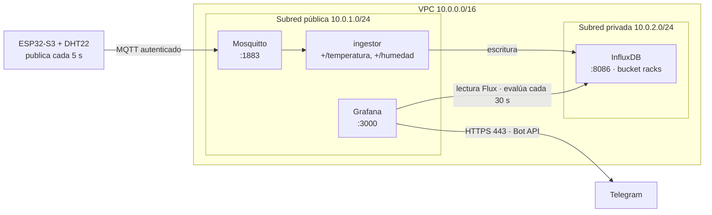
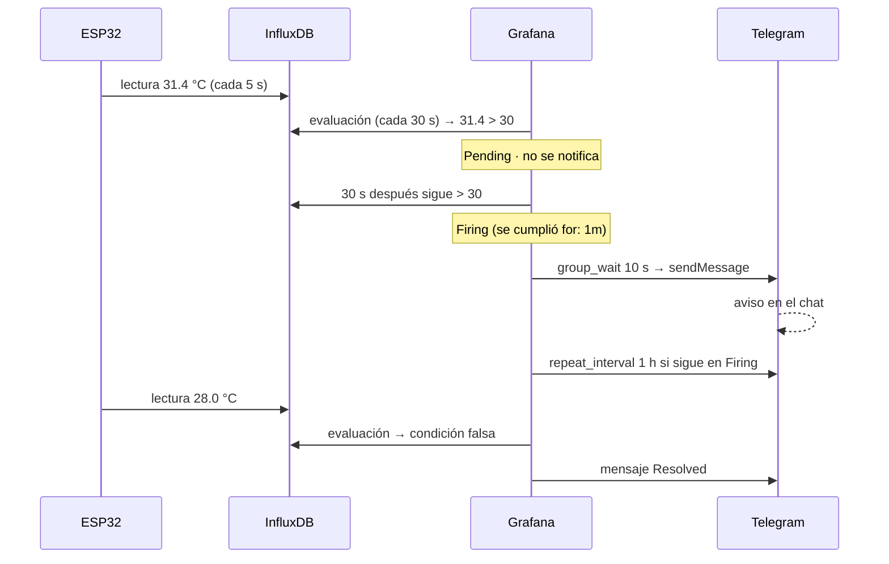

# Grafana y alertas por Telegram

Este documento explica cómo está montado Grafana en la EC2 del bróker, de dónde salen las
reglas y el dashboard, qué se ve en cada panel, cómo se evalúan las cuatro alertas y cómo el
bot de Telegram entrega (y repite) los avisos. Todo lo que se describe está versionado en el
repositorio; no hay configuración hecha a mano dentro de la instancia.

| Archivo | Qué define |
|---|---|
| [`grafana/instalar.sh`](../grafana/instalar.sh) | Instalación idempotente: Grafana, datasource, dashboard y alertas |
| [`grafana/provisioning/datasources/influxdb.yaml`](../grafana/provisioning/datasources/influxdb.yaml) | Conexión a InfluxDB (Flux) |
| [`grafana/provisioning/dashboards/racks.yaml`](../grafana/provisioning/dashboards/racks.yaml) | Carpeta desde la que se cargan los dashboards |
| [`grafana/dashboards/racks.json`](../grafana/dashboards/racks.json) | Dashboard *Monitoreo de racks* |
| [`grafana/provisioning/alerting/reglas.yaml`](../grafana/provisioning/alerting/reglas.yaml) | Las cuatro reglas de alerta |
| [`grafana/provisioning/alerting/telegram.yaml`](../grafana/provisioning/alerting/telegram.yaml) | Contact point y política de notificación |

Los secretos no están en el repositorio: el token de InfluxDB, el token del bot y la clave de
`admin` viven en `/home/ubuntu/.env.grafana` (`640 ubuntu:grafana`), que systemd carga como
`EnvironmentFile` del servicio.

## Cómo encaja en el sistema



El ESP32 publica cada 5 s, pero Grafana no consulta InfluxDB en cada lectura: el dashboard
refresca cada 30 s y las reglas se evalúan cada 30 s. Esa es la cadencia que importa para
entender cuándo llega un aviso.

## Cómo se construyó

Grafana se configuró como **código**, no haciendo clic en la interfaz. La carpeta
[`grafana/`](../grafana/) contiene los archivos de *provisioning* que Grafana lee al arrancar
y que `instalar.sh` copia a `/etc/grafana/provisioning/` y `/var/lib/grafana/dashboards/`.

Todas las piezas comparten la misma estructura:

- `apiVersion: 1` y `orgId: 1` en cada archivo de provisioning.
- Las conexiones entre piezas se hacen por **uid**, no por nombre visible: el datasource se
  llama `InfluxDB` pero su uid es `influxdb-racks`, y ese uid es el que usan las consultas
  de las reglas y los paneles del dashboard.
- Los valores sensibles son referencias `${VARIABLE}` que Grafana sustituye desde el
  entorno del proceso; el valor real lo pone systemd con
  `EnvironmentFile=/home/ubuntu/.env.grafana`.

En el arranque, Grafana procesa en este orden: datasources, dashboards (el *provider* vigila
la carpeta) y alerting (contact points, políticas y reglas). Por eso `instalar.sh` copia todo
antes de reiniciar el servicio.

### Por qué no se edita desde la web

Los recursos creados por provisioning son de solo lectura en la interfaz:

| Recurso | Por qué no se guarda desde la UI |
|---|---|
| Datasource | `editable: false` en `influxdb.yaml` |
| Reglas y contact points | Provisionados: cualquier cambio hecho en la UI se pierde al recargar |
| Dashboard | *Provider* `type: file` sin `allowUiUpdates`: Grafana bloquea guardar sobre el original |

En la práctica, la web sirve para **mirar** (estado de reglas, historial de envíos, series) y
para prototipar. Cuando un cambio sirve, se traslada al archivo del repo y se vuelve a
ejecutar `instalar.sh`. Desde la UI solo se puede crear una copia con **Save as**, que no
está versionada y no se reproduce en otra instancia.

Dos matices de la interpolación que explican varios detalles del repo:

- Grafana solo sustituye variables de entorno en **MAYÚSCULAS**. Por eso las anotaciones
  pueden usar `$values.B.Value` con una sola `$` sin que se rompan.
- Las **plantillas de notificación** y las **anotaciones** son la excepción: no admiten
  `${...}`. En cambio `settings.message` del contact point sí se interpola, y ahí las
  variables de plantilla deben escaparse como `$$labels`, `$$values`.

## Instalación y aprovisionamiento

`grafana/instalar.sh` se ejecuta en la EC2 del bróker y es idempotente (se puede repetir):

```bash
scp -r grafana ubuntu@<IP_ELASTICA>:/home/ubuntu/
ssh -t ubuntu@<IP_ELASTICA> "bash /home/ubuntu/grafana/instalar.sh"
```

Los seis pasos, en orden:

1. **Variables de entorno.** Comprueba que existe `/home/ubuntu/.env.grafana` y que las siete
   variables tienen valor: `INFLUX_URL`, `INFLUX_ORG`, `INFLUX_BUCKET`, `INFLUX_TOKEN`,
   `TELEGRAM_BOT_TOKEN`, `TELEGRAM_CHAT_ID` y `GF_SECURITY_ADMIN_PASSWORD`. La plantilla es
   [`grafana/.env.grafana.example`](../grafana/.env.grafana.example).
2. **Swap de 1 GB.** Crea `/swapfile` si no existe, lo añade a `/etc/fstab` y fija
   `vm.swappiness=10`; sin swap, Grafana puede morir por falta de memoria en una instancia de
   1 GB de RAM.
3. **Instala Grafana.** Añade el repositorio APT oficial con su clave GPG; si el repositorio
   falla, cae al `.deb` oficial (`grafana_latest_amd64.deb`).
4. **Copia el provisioning.** Los YAML van a `/etc/grafana/provisioning/` y el JSON del
   dashboard a `/var/lib/grafana/dashboards/`; los de datasource y alerting quedan como
   `640 root:grafana` y el JSON como `grafana:grafana`.
5. **Conecta los secretos.** Instala el drop-in
   `/etc/systemd/system/grafana-server.service.d/10-env-file.conf` con
   `EnvironmentFile=/home/ubuntu/.env.grafana`, recarga systemd, habilita y arranca el
   servicio, espera a `/api/health` y aplica la clave de `admin` con `grafana cli`.
6. **Verifica.** Consulta `/api/health`, la salud del datasource y cuenta las reglas y los
   contact points provisionados; al final imprime la URL de acceso.

Destinos en la EC2:

| Archivo del repo | Destino |
|---|---|
| `provisioning/datasources/influxdb.yaml` | `/etc/grafana/provisioning/datasources/` |
| `provisioning/dashboards/racks.yaml` | `/etc/grafana/provisioning/dashboards/` |
| `provisioning/alerting/reglas.yaml` | `/etc/grafana/provisioning/alerting/` |
| `provisioning/alerting/telegram.yaml` | `/etc/grafana/provisioning/alerting/` |
| `dashboards/racks.json` | `/var/lib/grafana/dashboards/racks.json` |

Si se agrega un archivo nuevo a `provisioning/alerting/`, hay que añadir su `cp` (y su
`chown`/`chmod`) a `instalar.sh`; de lo contrario se queda en el repo y Grafana nunca lo ve.

## La fuente de datos

El datasource se llama **InfluxDB**, tiene uid `influxdb-racks`, es el predeterminado y no se
puede editar desde la web. Usa Flux y apunta a la instancia privada:

| Ajuste | Valor |
|---|---|
| URL | `${INFLUX_URL}` → `http://10.0.2.116:8086` |
| Organización | `${INFLUX_ORG}` → `uao` |
| Bucket por defecto | `${INFLUX_BUCKET}` → `racks` |
| Token | `${INFLUX_TOKEN}` (permiso de **solo lectura**, en `secureJsonData`) |
| Acceso | `proxy`: la consulta la hace el servidor de Grafana, no el navegador |

Los datos los escribe el ingestor con esta forma:

| Elemento | Valor |
|---|---|
| Medición | `ambiente` |
| Tag | `rack=rack1` |
| Fields | `temperatura`, `humedad` |
| Marca de tiempo | UTC, puesta por el ingestor |
| Cadencia | una lectura cada 5 s por variable (dos puntos cada 5 s) |

Por eso todas las consultas filtran `_measurement == "ambiente"`, `_field` y `r.rack ==
"rack1"`.

## Anatomía de una regla de alerta

Cada regla de `reglas.yaml` se escribió a mano con la misma estructura: tres consultas
encadenadas (`refId` A, B y C) y una condición. El ejemplo es `rack-temperatura-alta`:

| `refId` | `datasourceUid` | Tipo | Qué hace |
|---|---|---|---|
| A | `influxdb-racks` | Flux | Lee `temperatura` de los últimos 5 min y aplica `last()` |
| B | `__expr__` | `reduce` | Convierte la serie de A en un único número con `reducer: last` |
| C | `__expr__` | `threshold` | Compara B con el umbral: `evaluator: gt, params: [30]` |

La regla declara `condition: C`, así que se dispara cuando C se cumple. El `relativeTimeRange`
de A (`from: 300, to: 0`) es la ventana de datos; el `interval: 30s` del grupo es cada cuánto
se evalúa.

La consulta Flux de A es la misma que usan los paneles, con el rango fijo:

```flux
from(bucket: "racks")
  |> range(start: -5m)
  |> filter(fn: (r) => r._measurement == "ambiente" and r._field == "temperatura" and r.rack == "rack1")
  |> last()
```

El resto de campos de la regla:

| Campo | Efecto |
|---|---|
| `for` | Tiempo que la condición debe sostenerse antes de pasar a *Firing* |
| `noDataState` | Qué hacer si la consulta no devuelve puntos (`OK` o `Alerting`) |
| `execErrState` | Qué hacer si la consulta falla (`Error`) |
| `labels` | `severidad` y `rack`, que viajan en el mensaje |
| `annotations` | `summary` (valor y umbral) y `description` (qué revisar) |

Las anotaciones usan la plantilla de Grafana, por ejemplo:

```yaml
summary: 'Temperatura alta en rack1: {{ printf "%.1f" $values.B.Value }} °C (umbral 30 °C)'
```

`$values.B.Value` es el número que produjo la consulta B, formateado con un decimal. Es el
detalle que hace útiles los mensajes: en lugar de «umbral superado», llega el valor real.

## Las cuatro reglas

Las cuatro reglas están en la carpeta **Racks**, con `interval: 30s` a nivel de grupo:

| Regla (`uid`) | Ventana consultada | Condición | `for` | Severidad |
|---|---|---|---|---|
| `rack-temperatura-alta` | últimos 5 min, `last()` | temperatura > 30 °C | 1 min | alta |
| `rack-humedad-alta` | últimos 5 min, `last()` | humedad > 80 % | 1 min | media |
| `rack-humedad-baja` | últimos 10 min, `last()` | humedad < 40 % | 5 min | media |
| `rack-sin-datos` | último 1 min, `count` | menos de 1 punto | 5 min | alta |

Comportamiento que evita falsos positivos:

- Al evaluarse cada 30 s, la condición debe sostenerse el tiempo del `for` (1 o 5 min) antes
  de pasar a **Firing**. Un pico aislado solo deja la regla en **Pending**.
- Las tres reglas de umbral llevan `noDataState: OK`: si InfluxDB no devuelve puntos, no
  alertan, porque de eso se encarga `rack-sin-datos`.
- `rack-sin-datos` lleva `noDataState: Alerting`: si en el último minuto no hay filas, la
  consulta B no tiene serie, Grafana marca *No data* y, tras 5 min, la regla pasa a
  **Firing**. Si sí hay datos, `count` es 1 o más y C (`lt 1`) es falso.
- `execErrState: Error`: si falla la consulta (InfluxDB caída, token inválido), la regla
  queda en *Error* y el aviso lo indica.
- `rack-sin-datos` consulta solo `temperatura` a propósito: basta una variable para saber si
  el rack está publicando.

## Qué se ve en el dashboard

El dashboard **Monitoreo de racks** (uid `racks`) abre en `http://<IP_ELASTICA>:3000` con
usuario `admin` y la clave de `GF_SECURITY_ADMIN_PASSWORD`. El acceso anónimo está
desactivado: sin sesión, Grafana responde `401`.

Tiene cuatro paneles para `rack1`, en rango `now-7d` y refresco cada 30 s:

| Panel | Tipo | Qué pregunta responde | Cómo lo resuelve |
|---|---|---|---|
| Temperatura actual (rack1) | Stat | ¿Cuál fue la última temperatura? | `last()` en el rango + `lastNotNull`, un decimal, fondo verde/rojo en 30 °C |
| Humedad actual (rack1) | Stat | ¿Cuál fue la última humedad? | `last()` + `lastNotNull`, fondo rojo < 40 %, verde 40–80 %, rojo desde 80 % |
| Temperatura (rack1) | Timeseries | ¿Cómo evolucionó la temperatura? | `aggregateWindow(mean)` con `v.windowPeriod`, línea y área roja desde 30 °C |
| Humedad (rack1) | Timeseries | ¿Cómo evolucionó la humedad? | `aggregateWindow(mean)`, línea y área roja desde 80 % |

Cómo funcionan, en la práctica:

- **Los dos stat no son «en vivo»**: muestran el último valor válido de los últimos 7 días
  (`lastNotNull`). Si el ESP32 se apagó hace dos días, el panel sigue mostrando esa última
  lectura. Sirven para el valor puntual; para saber si es reciente hay que mirar la serie o
  el estado de `rack-sin-datos`.
- **Los timeseries se suavizan según el rango**: `v.windowPeriod` es el intervalo que Grafana
  calcula según el ancho del panel y el rango. Con `now-7d` cada punto es un promedio de un
  bloque grande y la curva se ve limpia; con `now-1h` se aprecia el detalle de los 5 s.
- **Los umbrales son visuales, no lógicos**: tiñen el fondo del stat y dibujan la línea y el
  área de alerta en las gráficas. Quien decide y notifica son las reglas de alerta.
- **Unidades y decimales** están fijados en el JSON: `celsius`, `humidity` y un decimal.
- **El dashboard está fijo a `rack1`**: la etiqueta está en las consultas, no hay variable de
  plantilla. Para monitorear un segundo rack habría que duplicar la consulta o parametrizarla.
- **Es de solo lectura por provisioning**: el JSON se aplica al reinstalar. Para dejar un
  cambio fijo se edita `grafana/dashboards/racks.json` y se vuelve a ejecutar `instalar.sh`;
  desde la web solo cabe **Save as** (copia no versionada).

Dónde mirar el estado de las alertas dentro de Grafana:

- **Alerting → Alert rules** → carpeta **Racks**: estado de cada regla (*Normal*, *Pending*,
  *Firing*, *No data*, *Error*) y desde cuándo.
- **Alerting → Contact points → Telegram → View history**: cada intento de envío y su
  resultado.
- **Alerting → Silences**: silencios temporales, útil durante mantenimiento.

## El bot de Telegram

Grafana no habla con Telegram por sí solo: lo hace a través de un **contact point** de tipo
`telegram` llamado `telegram-racks`:

| Ajuste | Valor |
|---|---|
| Tipo | `telegram` |
| `bottoken` | `${TELEGRAM_BOT_TOKEN}` (token que entrega BotFather) |
| `chatid` | `${TELEGRAM_CHAT_ID}` (chat o grupo destino) |
| `disableResolveMessage` | `false` → también envía el aviso de resolución |

Cómo se prepara (una sola vez):

1. En Telegram, se habla con **@BotFather**, se crea el bot con `/newbot` y se copia el token
   (formato `123456789:AA...`).
2. Se escribe algo al bot desde la cuenta o el grupo destino y se consulta
   `https://api.telegram.org/bot<TOKEN>/getUpdates` para obtener el `chat_id`.
3. Ambos valores se guardan en `/home/ubuntu/.env.grafana`; el YAML solo contiene las
   referencias `${...}`.

### La política de notificación

`telegram.yaml` define una única política raíz, así que **todas** las alertas van al mismo
chat:

| Campo | Valor | Efecto |
|---|---|---|
| `receiver` | `telegram-racks` | Todo se entrega por el bot |
| `group_by` | `["grafana_folder", "alertname"]` | Agrupa avisos de la misma carpeta y nombre |
| `group_wait` | `10s` | Espera 10 s tras la primera alerta del grupo antes de enviar |
| `group_interval` | `1m` | Cada minuto puede reenviar el grupo si cambia (nueva alerta o resolución) |
| `repeat_interval` | `1h` | Si sigue en Firing, repite el aviso cada hora |

### Cuándo se envía un mensaje

1. La regla se evalúa cada **30 s**. Mientras la condición no se cumple, está *Normal*.
2. Cuando se cumple pero aún no ha pasado el `for`, queda *Pending*: **no se envía nada**.
3. Al superar el `for`, pasa a **Firing** y se encola una notificación. La política espera
   `group_wait` (10 s) y la envía al chat.
4. Si la condición se mantiene, el aviso se repite cada `repeat_interval` (1 h), no en cada
   evaluación.
5. Cuando la condición deja de cumplirse, la regla vuelve a *Normal* y se envía un mensaje de
   **resolución** (porque `disableResolveMessage` es `false`), sujeto al `group_interval` de
   1 min.

En resumen: **no hay un mensaje cada 30 s**. Hay un mensaje al entrar en Firing, un
recordatorio por hora mientras dure, y uno al resolverse.

### Cómo lo envía

Grafana usa la Bot API de Telegram: una petición HTTPS a
`https://api.telegram.org/bot<token>/sendMessage` con el `chat_id` y el texto del mensaje,
formateado con la plantilla por defecto de Grafana. La EC2 necesita salida a internet por el
puerto 443 (la tiene, porque también descarga paquetes y consulta la API de Telegram).

El texto sigue esta estructura (plantilla por defecto, con el ejemplo de `rack-sin-datos`):

```text
**Firing**

Value: [ var='B' labels={} value=1.0 ], [ var='C' labels={} value=1.0 ]
Labels:
 - alertname = Sin datos de rack1
 - grafana_folder = Racks
 - rack = rack1
 - severidad = alta
Annotations:
 - description = Revisa el ESP32, el broker Mosquitto y el servicio ingestor.
 - summary = Sin datos de rack1: no llegan lecturas desde hace ~5 minutos
Silence: http://<IP_ELASTICA>:3000/alerting/silence/new?...
Source: http://<IP_ELASTICA>:3000/alerting/grafana/...
```

Lo importante de cada bloque:

- **`**Firing**` / `**Resolved**`** — estado que originó el mensaje.
- **`Value`** — valores de las consultas de la regla; en las reglas de umbral el número útil
  es el de B (temperatura, humedad o cantidad de puntos), y por eso `summary` lo imprime con
  `{{ printf "%.1f" $values.B.Value }}`.
- **`Labels`** — `alertname`, `grafana_folder`, `rack` y `severidad`, que permiten filtrar y
  agrupar.
- **`Annotations`** — `summary` (una línea con el valor y el umbral) y `description` (qué
  revisar).
- **`Silence` y `Source`** — enlaces a Grafana para silenciar la alerta o ver la regla.

Los textos exactos de `summary` y `description` de cada regla están en `reglas.yaml`; por
ejemplo, la de temperatura alta dice
`Temperatura alta en rack1: 31.4 °C (umbral 30 °C)`.

## Personalizar el mensaje

Hay **dos niveles** y conviene no confundirlos:

| Nivel | Dónde vive | Qué controla |
|---|---|---|
| Anotaciones (`summary`, `description`) | `reglas.yaml` | El texto útil de cada alerta: valor, umbral, qué revisar |
| Plantilla de notificación | Un YAML de `templates` + `message` en `telegram.yaml` | El formato del mensaje: título, estado, orden, campos, enlaces |

Hoy las anotaciones ya están personalizadas y el formato es el **por defecto** de Grafana.
Para cambiar el formato se agrega una plantilla con nombre:

**1. Crear `grafana/provisioning/alerting/plantillas.yaml`:**

```yaml
apiVersion: 1
templates:
  - orgId: 1
    name: telegram-racks
    template: |
      {{ define "telegram-racks" -}}
      {{ if eq .Status "firing" }}ALERTA{{ else }}RESUELTA{{ end }} · {{ .CommonLabels.alertname }}
      {{ range .Alerts -}}
      {{ .Annotations.summary }}
      {{ .Annotations.description }}
      {{ end }}
      Rack: {{ .CommonLabels.rack }} · Severidad: {{ .CommonLabels.severidad }}
      {{ .ExternalURL }}
      {{- end }}
```

**2. Decirle al contact point que la use** (dentro de `settings` en `telegram.yaml`):

```yaml
        settings:
          bottoken: ${TELEGRAM_BOT_TOKEN}
          chatid: "${TELEGRAM_CHAT_ID}"
          message: '{{ template "telegram-racks" . }}'
```

**3. Enseñarle el archivo a `instalar.sh`**: añadir el `cp` de `plantillas.yaml` y meterlo en
las líneas de `chown root:grafana` y `chmod 640`. Sin ese paso el archivo no llega a la EC2.

**4. Aplicar**: `bash /home/ubuntu/grafana/instalar.sh`, o recargar el provisioning sin
reiniciar:

```bash
curl -fsS -u "admin:$GF_SECURITY_ADMIN_PASSWORD" -X POST \
  localhost:3000/api/admin/provisioning/alerting/reload
```

Reglas que hay que respetar:

- **La plantilla no admite variables de entorno**: `${...}` no se sustituye ahí, igual que en
  las anotaciones. Por eso la plantilla no debe contener secretos.
- **`settings.message` sí se interpola**: si se escribe `{{ $labels }}` en ese campo, hay que
  escaparlo como `{{ $$labels }}`. En la plantilla propuesta se usan solo campos
  (`.CommonLabels`, `.Annotations`), así que no aplica.
- **Telegram corta en 4096 caracteres**. Como se agrupa por `alertname`, un mensaje lleva
  pocas alertas; aun así, conviene no imprimir todo `.Alerts` sin filtrar.
- **Formato Markdown**: `*`, `_`, `[`, `]` y `` ` `` literales deben escaparse; una URL con
  `_` es el caso típico que rompe el envío.
- **Campos disponibles**: `.Status` (`firing`/`resolved`), `.Alerts` (`.Firing`, `.Resolved`),
  `.CommonLabels`, `.CommonAnnotations`, `.GroupLabels`, `.ExternalURL`, y por alerta
  `.Labels`, `.Annotations`, `.StartsAt`, `.EndsAt`, `.GeneratorURL`, `.SilenceURL`. Se pueden
  usar `if`, `range`, `index`, `len`, `printf` y `eq`.
- **Hora**: `.StartsAt` llega en UTC; para hora local existe la función `tz`.
- **Los recursos provisionados no se editan en la web**, así que el cambio siempre pasa por el
  archivo y la recarga.

Cómo probarlo:

1. **Test** del contact point en *Alerting → Contact points* (Grafana Alertmanager lo
   permite aunque esté provisionado): envía un mensaje con alertas sintéticas.
2. **Historial**: *Alerting → Contact points → Telegram → View history* muestra cada intento
   y el error si falló.
3. **Prueba real**: bajar temporalmente un umbral en `reglas.yaml`, recargar, esperar el
   `for` y restaurar; o detener el ingestor ~6 min para el aviso de `rack-sin-datos`.

## Línea de tiempo de una alerta

Ejemplo con la temperatura, suponiendo que el sensor cruza los 30 °C justo después de una
evaluación:



El peor caso es `for` + una evaluación completa (30 s) + `group_wait` (10 s):

| Alerta | Desde que ocurre la condición | Primer mensaje |
|---|---|---|
| Temperatura alta | 1 min de `for` | entre ~1 min 10 s y ~1 min 40 s |
| Humedad alta | 1 min de `for` | entre ~1 min 10 s y ~1 min 40 s |
| Humedad baja | 5 min de `for` | entre ~5 min 10 s y ~5 min 40 s |
| Sin datos | 5 min de `for` con la consulta vacía | entre ~5 min 10 s y ~5 min 40 s |

Si la condición desaparece antes de completar el `for`, la regla vuelve a *Normal* sin enviar
nada.

## Operación y diagnóstico

Estado del servicio y registros:

```bash
sudo systemctl status grafana-server
sudo journalctl -u grafana-server -n 50 --no-pager
sudo journalctl -u grafana-server -f | grep -i -E "alert|telegram|notif"
```

Comprobar lo provisionado sin abrir la web:

```bash
set -a; . /home/ubuntu/.env.grafana; set +a
curl -fsS -u "admin:$GF_SECURITY_ADMIN_PASSWORD" localhost:3000/api/health
curl -fsS -u "admin:$GF_SECURITY_ADMIN_PASSWORD" \
  localhost:3000/api/v1/provisioning/alert-rules | grep -o '"title":"[^"]*"'
curl -fsS -u "admin:$GF_SECURITY_ADMIN_PASSWORD" \
  localhost:3000/api/v1/provisioning/contact-points | grep -o '"name":"[^"]*"'
```

Probar el bot por fuera de Grafana (útil para descartar token o `chat_id`):

```bash
set -a; . /home/ubuntu/.env.grafana; set +a
curl -s "https://api.telegram.org/bot$TELEGRAM_BOT_TOKEN/getMe"
curl -s -X POST "https://api.telegram.org/bot$TELEGRAM_BOT_TOKEN/sendMessage" \
  --data-urlencode "chat_id=$TELEGRAM_CHAT_ID" \
  --data-urlencode "text=Prueba del bot de racks"
```

Provocar una alerta sin ESP32 (y revertir después):

- **Sin datos:** `sudo systemctl stop ingestor` y esperar ~6 min; luego
  `sudo systemctl start ingestor`.
- **Umbral:** editar el umbral en `reglas.yaml` por debajo del último valor, recargar el
  provisioning, esperar el `for` y restaurar el archivo.

Si el aviso no llega, revisar en este orden: **Alerting → Contact points → Telegram → View
history** (¿hubo intento y con qué error?), `journalctl` (¿falló la evaluación?), el token y
el `chat_id` con las llamadas de arriba, y la salida a internet de la EC2.

## Limitaciones y mejoras

- **MQTT sin cifrar** en `:1883`; la mejora es TLS en `:8883`.
- **Puerto 3000 permitido en el Security Group**: conviene restringirlo a la IP del
  administrador, igual que el 22, o acceder por túnel SSH.
- **Un solo destino y una sola política**: no hay escalado por severidad ni destinatarios
  distintos para `alta` y `media`.
- **`repeat_interval` de 1 h**: si el rack se queda horas fuera de rango, el chat recibe un
  recordatorio cada hora; para episodios largos puede ser ruidoso.
- **Los stat pueden mostrar un valor viejo**: al usar una ventana de 7 días y `lastNotNull`,
  el número sigue visible aunque el sensor esté apagado; la antigüedad se deduce de la serie o
  del estado de `rack-sin-datos`.
- **Sin variable de rack**: el dashboard y las reglas están fijos a `rack1`.
- **Estado de alertas solo en la vista nativa** de Grafana; no hay panel en el dashboard que
  muestre el estado de las reglas.
- **Dependencia del ingestor**: si se detiene, el dashboard deja de actualizarse y a los
  ~5 min salta `rack-sin-datos`, que es justo el comportamiento buscado.
